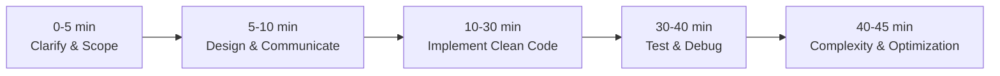

# Live Python Coding Test Strategy | The 6-Step Game Plan

The email states:
> *"The interview process includes a live Python coding test. You should be comfortable writing and debugging Python code independently, solving problems in real time and explaining your approach as you code."*

Here is the exact playbook to score maximum points.

---

## ⏱️ The 45-Minute Live Coding Timeline

---

## 1. Step 1: Clarify & Confirm Inputs (0 - 5 min)
**Do NOT immediately start typing code.** Strong senior engineers always clarify boundaries first:
- *"Before jumping into the implementation, let me confirm the requirements and constraints."*
- Ask about scale:
  - *"What is the expected volume of input data? Should this fit in memory or stream via a generator?"*
  - *"What should happen when an invalid input is received? (Raise an exception, log warning, or return None?)"*
  - *"Is this running in a multi-threaded or asynchronous environment?"*

## 2. Step 2: Propose the Architecture Out Loud (5 - 10 min)
- State your high-level strategy in 2-3 sentences:
  - *"I'm going to model this with a clean class/dataclass to maintain state..."*
  - *"For the algorithm, Kahn's algorithm with an in-degree map will allow us to achieve $O(V + E)$ time and easily segment parallel execution stages."*
- Ask: *"Does this approach sound good to you, or would you prefer a different trade-off?"*

## 3. Step 3: Write Clean, Idiomatic Python (10 - 30 min)
- **Use Type Annotations:** `def process_records(items: List[str]) -> Dict[str, int]:` (shows senior software engineering maturity).
- **Use Standard Library Powerhouses:**
  - `collections.defaultdict`, `collections.deque`, `collections.Counter`
  - `dataclasses.dataclass`
  - `time.monotonic()` (for durations / rate limits, never `time.time()`)
  - `functools.wraps` (for decorators)
- **Talk While You Code:**
  - Narrate: *"Now I'm initializing the in-degree dictionary..."*
  - *"Here I'm wrapping the HTTP call in a try/except block to catch retryable exceptions..."*

## 4. Step 4: Test & Self-Debug (30 - 40 min)
- When done writing, **do not say "I'm done"**. Instead say:
  - *"Let's trace through an example and write test cases to verify the behavior."*
- Proactively test:
  1. Standard happy path
  2. Edge cases (empty inputs, zero values, single item)
  3. Error condition (cycles in graph, rate limit exceeded, transient network error)
- If a bug appears, stay calm:
  - *"Ah, I see we have an off-by-one here because the list index starts at 0. Let me adjust the bounds."*

## 5. Step 5: Big-O Complexity & Trade-Offs (40 - 45 min)
- State Time Complexity: e.g. $O(N)$ or $O(V + E)$
- State Space Complexity: e.g. $O(N)$ auxiliary memory
- Mention Production Polish:
  - *"In a live production service at Woven, I'd also add Prometheus latency metrics, structured JSON logging with correlation IDs, and circuit breakers."*

